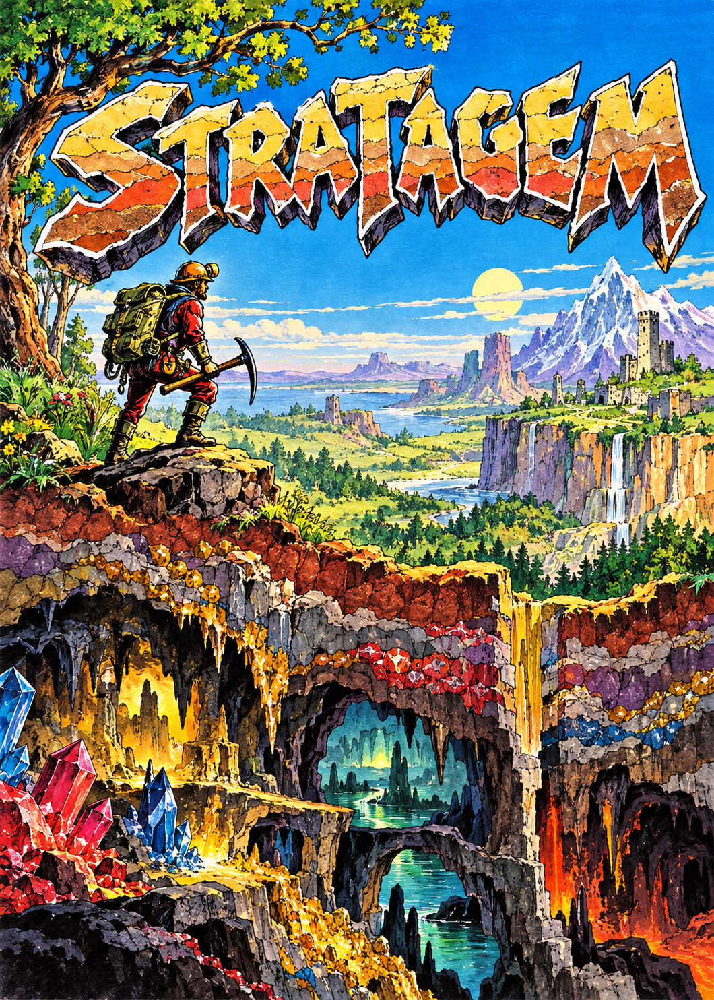

# Stratagem

[](https://github.com/rob-smallshire/stratagem/actions/workflows/ci.yml)

> **Unfinished, and in development.** Stratagem is a game being made, not a
> game to play yet: the world, digging, building, light, the day and its
> music are there, but much of the game isn't, and anything here may change.

<p align="center">
  
  
</p>
<p align="center"><em>The cover art, and the game at dusk, in the Beebium emulator.</em></p>

Stratagem is an open-world digging and building game for the BBC Micro, in
the spirit of *Terraria*, made with technology like *Exile*'s: a world of
256 × 256 tiles, generated as it's needed and smoothly scrolled, with a
miner who digs, carries, crafts and builds in it. Light comes from the sun
by day and from torches by night; the day turns, and an orchestral score
for the Music 5000 follows it. Nature is the game's subject: immense,
ancient and indifferent, to be discovered rather than conquered.

It is written in 6502 assembly (beebasm), with its tables generated and its
behaviour tested from Python.

## What it runs on

- **A BBC Micro B+ 128K, a Model B with an Integra-B board, or a Master
  128**, each with at least three free 16K banks of sideways RAM. A fourth
  holds the game's music.
- **A 6502 second processor:** a 3 MHz 65C02, or a 4 MHz 65C102 (a
  Master Turbo). The game
  runs on the second processor; the BBC Micro does the rendering and music.
- **A Music 5000**, if you have one, for the music. Without one, the game
  is silent.

The OS and the filing system stay resident: the game loads with ordinary
OS calls. On the B+ and the Integra-B that means DFS: an ADFS or network
filing system ROM raises PAGE above the &1900 the game needs. The ADFS
image (`.adl`) is for the Master, where PAGE stays low.

It is developed and tested in the
[Beebium](https://github.com/rob-smallshire/beebium) emulator, and on the
Master, which Beebium doesn't emulate yet, in
[b2](https://github.com/tom-seddon/b2) (`uv run strat-b2`). On real
hardware it has run on a Master Turbo, from the ADFS disc. In Beebium, import
`presets/stratagem-b-plus-128k-65c02.json` (File > Import Presets...), a
B+ 128K with a 3 MHz 65C02, insert the `.ssd` disc image and press
Shift-Break, then SPACE.

Disc images come with each
[release](https://github.com/rob-smallshire/stratagem/releases), or build
them yourself (below): `stratagem-vX.Y.Z.ssd` for DFS, and
`stratagem-vX.Y.Z.adl`, an ADFS copy. Each disc also holds a README, the
LICENSE, and a file named for the version (e.g. `0_1_0`), so `*CAT` shows
which version it is.

## Building

Requires [uv](https://docs.astral.sh/uv/) and
[beebasm](https://github.com/stardot/beebasm) on the `PATH`.

```sh
uv run strat-build                    # build/stratagem-vX.Y.Z.ssd (DFS) and .adl (ADFS)
uv run pytest -m "not slow"           # the quick tests, in Beebium and py65
uv run pytest                         # all of them, on both machines
uv run --group test strat-screenshot  # the screenshot above, from the game
```

CI builds the discs, keeps them as a `disc-images` artifact, and runs the
tests on every push to master and every pull request.

## Releasing

The version lives in `.bumpversion.toml`, with `pyproject.toml`,
`tools/stratagem/_version.py` and `uv.lock` kept equal to it.

```sh
uvx bump-my-version bump patch     # e.g. 0.1.0 -> 0.1.1: edits, commits and tags v0.1.1
git push --follow-tags             # push the commit and the tag
```

The tag triggers the release workflow: it runs the whole test suite, then
publishes a GitHub release (marked a pre-release) with the disc images.

## Finding out more

- [The miner's manual](docs/manual.md): the keys, the pack, making things.
- [The game design](docs/game-design.md), and
  [building, soil and support](docs/building.md).
- [The game on the Tube](docs/tube-game.md): how it is built, as it stands.
- [The decision log](docs/decisions.md): why things are as they are.
- [The musical direction](docs/musical-direction.md), and
  [the music's style](art/music/style.md).

## Licence

MIT: see [LICENSE](LICENSE).
